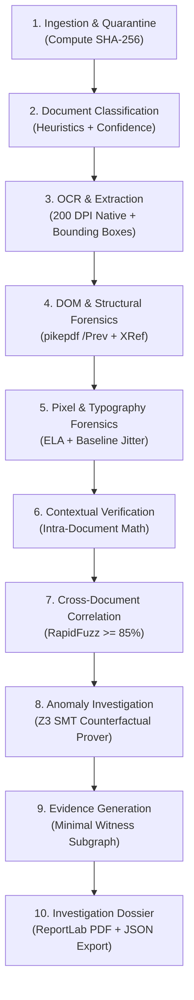

# VeriStrata CEIE — Counterfactual Evidence Investigation Engine
## Complete In-Depth System Context, Architecture & Developer Reference

> **Target Audience**: Any Large Language Model (LLM), Senior Systems Architect, or Hackathon Judge requiring complete, unambiguous, and deep context of the VeriStrata CEIE project to analyze, extend, debug, or evaluate the system without needing additional queries.
> **Aligned with**: DataOps Innovation Hackathon — Problem Statement 2 (PS-2: *AI-Powered Document Forensics and Contextual Intelligence System*).
> **Includes**: Full Workbench Unification (Prompt Pack v3) Architecture, Shared Component Library, and Dual-View System.

---

## 1. Executive Summary & System Philosophy

### 1.1 The Core Problem
Document discrepancy and tampering in retail lending, SME credit, insurance underwriting, and AP procurement cannot be reliably evaluated by standard Optical Character Recognition (OCR) or Large Language Model (LLM) extraction alone. Real-world processing exhibits two fatal failure modes:
1. **False Positives (Lack of Restraint)**: Legitimate applicants are unfairly rejected when multiple deposits sum up to their declared salary (e.g., split payroll transfers of ₹40,000 and ₹25,000 for a ₹65,000 monthly pay), or when banking holidays introduce settlement delays.
2. **False Negatives (Lack of Verification)**: Sophisticated bad actors alter payslips by modifying numbers directly within the PDF content stream or using graphic editing tools (modifying ₹65,000 to ₹95,000), leaving the rest of the layout visually pristine.

### 1.2 The VeriStrata Solution: Counterfactual Evidence Reasoning
**VeriStrata CEIE** (*Counterfactual Evidence Investigation Engine*) is an evidence-driven, multi-strata, mathematically proven forensic dataops platform that replaces fragile regex/heuristic rules with **Z3 Satisfiability Modulo Theories (SMT) Theorem Proving**, paired with **4-strata pixel and structural forensics**, **tamper-evident SHA-256 Merkle audit trails**, and a **unified darkroom investigation workbench**.

Instead of asking *"Does this single document look suspicious?"*, VeriStrata evaluates **counterfactual explanations** (hypotheses) across the entire multi-document bundle:
- *Hypothesis 1 ($H_{\text{split}}$)*: Did the employer pay the employee via multiple discrete bank transfers whose exact integer paise sum equals declared net salary?
- *Hypothesis 2 ($H_{\text{delay}}$)*: Did payroll credit post within a $\pm 5$-day calendar clearing window across month-end?
- *Hypothesis 3 ($H_{\text{gross}}$)*: Did the applicant enter gross compensation instead of net take-home pay?

If **any** counterfactual model is **SATISFIABLE (SAT)**, VeriStrata demonstrates **mathematical restraint** and categorizes the case as an `OBSERVATION` ($\Delta = \text{INR } 0.00$), preventing false alarms. If **all** counterfactual models are **UNSATISFIABLE (UNSAT)** and forensic signals confirm alterations, VeriStrata escalates to `POTENTIAL_MANIPULATION`, isolates the **minimal contradiction witness claims**, and produces a certified investigation dossier.

---

## 2. Global Repository Structure

```
C:\HACKATHONS\Data-ops\
├── backend/
│   ├── app/
│   │   ├── config.py                 # Canonical path resolution, data dirs, settings
│   │   ├── db.py                     # SQLite schema, open_db(), get_db(), insert()
│   │   ├── main.py                   # FastAPI entry point, lifespan, CORS, timing middleware
│   │   ├── routers/
│   │   │   ├── cases.py              # Case CRUD, status polling, graph, demo triggers
│   │   │   ├── documents.py          # Multipart upload, classification override, page render
│   │   │   ├── claims.py             # Claims list, /api/claims/{id}/crop endpoint (200 DPI PNG)
│   │   │   ├── findings.py           # Findings synthesis, evidence subgraphs, reviewer actions
│   │   │   ├── dossier.py            # Certified JSON and PDF export (PS-2 Section 7 aligned)
│   │   │   └── workbench.py          # Server-rendered HTML fallback report (/report/{id})
│   │   ├── schemas/
│   │   │   └── __init__.py           # Pydantic v2 data models for API requests/responses
│   │   ├── templates/
│   │   │   └── workbench.html        # Standalone HTML workbench template
│   │   ├── utils/
│   │   │   ├── audit.py              # write_audit() with SHA-256 previous-event hash chaining
│   │   │   └── helpers.py            # new_id(), now_iso(), sha256_*, JSON serializer
│   │   └── workers/
│   │       ├── ingest.py             # Quarantine raw uploads, compute SHA-256
│   │       ├── normalise.py          # 200 DPI page rendering via PyMuPDF (fitz)
│   │       ├── classify.py           # Keyword document classification & confidence
│   │       ├── extract_pdf.py        # Structured claim extraction with FIELD_MAP & bounding boxes
│   │       ├── extract_ocr.py        # OCR fallback engine (PaddleOCR graceful degradation)
│   │       ├── forensics_structural.py# PDF revisions, pikepdf DOM, font anomaly detection
│   │       ├── forensics_pixel.py    # Error Level Analysis (ELA) & Copy-Move keypoints
│   │       ├── rules_intra.py        # Intra-document arithmetic checks (gross - deductions = net)
│   │       ├── correlation.py        # Cross-document entity matching (RapidFuzz >= 85%)
│   │       ├── hypothesis.py         # Z3 SMT Theorem Prover counterfactual constraint engine
│   │       ├── findings.py           # Finding synthesis & escalation state machine
│   │       ├── graph.py              # NetworkX multi-layer evidence graph builder
│   │       └── dossier.py            # ReportLab PDF + Cryptographic JSON generator (PS-2 Sec 7)
│   └── tests/
│       └── test_e2e.py               # Pytest suite (Clean restraint, Tampered escalation, Corrupt file)
├── frontend/                         # Modern React 19 + TypeScript + Vite 8 + Tailwind CSS v4
│   ├── src/
│   │   ├── workbench/                # Unified shared forensic workbench component library
│   │   │   ├── WorkbenchShell.tsx    # 44px HUD, collapsible docks, zero-outer-margin shell
│   │   │   ├── DocumentStage.tsx     # 200 DPI canvas, pan/zoom (0.5x-4x), live loupe, reticles
│   │   │   ├── ClaimBox.tsx          # Accessible <button> reticle with 10px corner brackets
│   │   │   ├── ContradictionCompare.tsx # Split-stage side-by-side comparison with residual caliper
│   │   │   ├── EvidenceShelf.tsx     # Bundle document list & upload dropzone
│   │   │   ├── DocumentCard.tsx      # Individual document item card with status dot
│   │   │   ├── ProvenanceCard.tsx    # MIME type, page count, classifier confidence, SHA-256 chip
│   │   │   ├── WitnessPanel.tsx      # Minimal contradiction witness claims
│   │   │   ├── ResidualCallout.tsx   # Large serif residual amount (tabular count-up)
│   │   │   ├── HypothesisMatrix.tsx  # Z3 counterfactual disclosure accordions (SUPPORTED/REJECTED)
│   │   │   ├── SignalList.tsx        # Multi-strata pixel & typographical signal cards
│   │   │   ├── CropPreview.tsx       # Native 200 DPI PNG crop image with metadata
│   │   │   ├── AuditChain.tsx        # Cryptographic SHA-256 chain dock with in-browser verification
│   │   │   ├── StatusPill.tsx        # Standardized status badge using statusStyles tokens
│   │   │   └── Inspector.tsx         # Right dock grouping Witness, Residual, Hypotheses, Review CTA
│   │   ├── components/
│   │   │   ├── CaseStudioView.tsx    # Operational Investigation Studio container (#/studio)
│   │   │   ├── DashboardView.tsx     # Landing command center, stat counters, beat triggers
│   │   │   ├── DossierModal.tsx      # Certified JSON payload inspector & PDF trigger
│   │   │   ├── ForensicScanEffect.tsx# Anime.js v4 scanline sweep & animated counter
│   │   │   ├── Navbar.tsx            # System health pill, case switcher, demo launch
│   │   │   ├── NewCaseModal.tsx      # Interactive case initialization & PDF dropzone
│   │   │   ├── ReviewDrawer.tsx      # Slide-over review drawer with stamped seal animation
│   │   │   └── ThreeForensicCanvas.tsx# Interactive 3D Three.js holographic SMT core
│   │   ├── data/
│   │   │   └── useCaseData.ts        # Parallel data loader hook, polling backoff, recorded sample fallback
│   │   ├── lib/
│   │   │   ├── bbox.ts               # bboxToCss with float round-off protection & unit tests
│   │   │   ├── format.ts             # formatPaise (integer paise to INR), shortHash
│   │   │   ├── statusStyles.ts       # Status token mapping (lime, amber, ruby, cyan)
│   │   │   ├── motion.ts             # Custom cubic-bezier spring motion curves
│   │   │   └── __tests__/
│   │   │       └── unit.test.ts      # Automated unit tests for bboxToCss, formatPaise, statusStyles
│   │   ├── story/                    # The Autopsy Table 5-scene scroll story
│   │   │   ├── StoryPage.tsx         # Scroll story controller with Lenis smooth scrolling
│   │   │   └── scenes/
│   │   │       ├── SpecimenScene.tsx # Scene 01: Hero 3D tilted paper specimen with laser sweep
│   │   │       ├── LayersScene.tsx   # Scene 02: 4-strata exploded 3D view with ruby laser
│   │   │       ├── TrialScene.tsx    # Scene 03: Interactive compare slider (Clean vs Tampered)
│   │   │       ├── StudioScene.tsx   # Scene 04: Shared workbench components in preview mode
│   │   │       └── SealScene.tsx     # Scene 05: Cryptographic Merkle stamp & signed dossier
│   │   ├── api.ts                    # API client layer communicating with FastAPI
│   │   ├── App.tsx                   # Master router (#/, #/studio, #/styleguide) with query parsing
│   │   ├── index.css                 # Tailwind v4 theme, autopsy-grid, darkroom panel tokens
│   │   ├── main.tsx                  # React DOM entry point
│   │   └── types.ts                  # TypeScript interfaces mirroring backend contracts
│   ├── index.html                    # Fonts: Instrument Serif, Inter Tight, JetBrains Mono
│   ├── package.json                  # NPM dependencies (Three, Motion, Lenis, Anime.js, Tailwind v4)
│   └── vite.config.ts                # Vite config with @tailwindcss/vite
├── docs/
│   ├── DEMO_SCRIPT.md                # 2-minute judge walkthrough pitch script
│   └── WORKBENCH_UI_ARCHITECTURE.md  # Exhaustive Workbench UI architecture & LLM redesign blueprint
├── UNIFY-PLAN.md                     # Workbench unification audit and component extraction plan
├── data/
│   ├── originals/                    # Quarantined raw uploaded files by case_id/doc_id
│   ├── derivatives/                  # 200 DPI rendered PNG pages by case_id/doc_id/pages/
│   └── synthetic/                    # Synthetic PDF test bundles with ground truth
│       ├── clean_bundle/             # 4 Clean PDFs (₹65k salary, split bank credits ₹40k+₹25k)
│       ├── tampered_bundle/          # 4 Tampered PDFs (₹95k modified salary slip, font mismatch)
│       └── generate_bundle.py        # ReportLab generator for synthetic test data
├── run_demo.py                       # 5-Beat CLI judge demonstration script
├── tracedoc.db                       # SQLite primary database
└── README.md                         # Master Documentation
```

---

## 3. Data Flow & The 10-Step Forensic Pipeline

VeriStrata executes all 10 stages specified in PS-2 Section 6:



---

## 4. The 4 Forensic Strata Architecture

VeriStrata evaluates document evidence across four independent physical and digital strata:

### Strata I: File & PDF Object Model (DOM)
* **Worker:** `backend/app/workers/forensics_structural.py` (`pikepdf`)
* **Checks:** Incremental update markers (`%%EOF` count $>1$, multiple `xref` tables), trailer `/Prev` pointers, unreferenced font dictionaries, and modified metadata streams.

### Strata II: Pixel & Image Compression Forensics
* **Worker:** `backend/app/workers/forensics_pixel.py` (`OpenCV`, `PIL`)
* **Checks:**
  * **Error Level Analysis (ELA):** Recompresses rendered pages at standard quality factors (Q75, Q90). Manipulated or spliced numerical regions exhibit quantization error spikes ($>25/255$).
  * **Copy-Move Keypoint Search:** ORB feature keypoint clustering ($>15$ spatially distinct pairs with distance $>40\text{ px}$) to detect duplicated text patches or cloned corporate seals.

### Strata III: Micro-Typography & Layout Forensics
* **Worker:** `backend/app/workers/forensics_structural.py` (`fitz` / PyMuPDF)
* **Checks:**
  * **Inline Font Substitution:** Detects typeface switches within a single tabular row (e.g., standard `Helvetica` table interrupted by an injected `Georgia-Italic` font object).
  * **Baseline Origin Jitter:** Extracts character origin coordinates $(x, y)$. Misalignment $>1.2\text{ pt}$ from the median line baseline indicates manual text replacement.

### Strata IV: Cross-Document Contextual Reconciliation
* **Worker:** `backend/app/workers/correlation.py` (`rapidfuzz`) & `backend/app/workers/hypothesis.py` (`z3`)
* **Checks:**
  * **Employer Entity Resolution:** Token-sort ratio fuzzy matching ($\ge 85\%$) with corporate stopword stripping.
  * **Bank Narration Matching:** Matches employer identity against bank statement narration strings.
  * **Multi-Document SMT Solving:** Reconciles payslip earnings, employer declarations, and bank credit aggregates in integer paise.

---

## 5. Z3 SMT Counterfactual Hypothesis Engine

Located in `backend/app/workers/hypothesis.py`:

### Mathematical Formulation
All monetary amounts are normalized into integer paise ($1\text{ INR} = 100\text{ paise}$) to eliminate floating-point rounding errors.

Given:
* Declared net pay: $P \in \mathbb{Z}^+$ (e.g., $9,500,000\text{ paise} = \text{INR } 95,000.00$)
* Bank credit entries: $C = \{c_1, c_2, \dots, c_n\} \subset \mathbb{Z}^+$ (e.g., $\{4,000,000, 2,500,000\}\text{ paise}$)

### The Evaluated Hypotheses:
1. **$H_{\text{split}}$ (Split Payroll Credits):**
   $$\exists S \subseteq C \quad \text{such that} \quad \sum_{c \in S} c = P$$
   Formulated as a discrete 0-1 subset-sum constraint problem:
   $$\text{Minimize} \quad \Delta = \left| P - \sum_{i=1}^n b_i \cdot c_i \right|, \quad b_i \in \{0, 1\}$$
2. **$H_{\text{delay}}$ (Calendar Posting Window):**
   Accounts for weekend/holiday clearing delays by expanding the transaction search window across $\pm 5$ calendar days.
3. **$H_{\text{gross}}$ (Gross-vs-Net Deduction):**
   Verifies whether declared gross compensation minus standard statutory deductions (PF, Tax) satisfies the banking deposits.

### Decision Engine:
* If $\Delta = 0$ for any hypothesis: **REST (SAT)** $\implies$ Status: `OBSERVATION`. No escalation.
* If $\Delta > 0$ for all hypotheses: **ESCALATE (UNSAT)** $\implies$ Status: `POTENTIAL_MANIPULATION`. Isolates the **minimal contradiction witness claims** and calculates the exact residual:
  $$\Delta = \text{INR } 30,000.00 \quad (3,000,000\text{ paise})$$

---

## 6. The Unified Frontend Architecture (Prompt Pack v3)

The frontend is built with **React 19**, **TypeScript**, **Vite 8**, and **Tailwind CSS v4**. Under Prompt Pack v3, the story (`#/`) and the studio (`#/studio`) share **one unified component library** residing in `frontend/src/workbench/`.

### 6.1 Shared Component Library (`src/workbench/`)
Every component accepts `mode: "preview" | "full"`:
* **`WorkbenchShell.tsx`**: The docked darkroom container featuring a 44px Top HUD with real-time pipeline status pills (`INGEST`, `EXTRACT`, `SOLVE`, `FINDINGS`), collapsible left/right docks with keyboard separators, and zero-outer-margin styling.
* **`DocumentStage.tsx`**: Pan & zoom (0.5x to 4x) 200 DPI canvas, layer toggles (`Witness`, `Fields`, `Signals`), reticle `ClaimBox` buttons with 10px corner brackets, coordinate readout bar with click-to-copy, and an interactive **Live 200 DPI Loupe** (180px circle tracking cursor at 3x-6x native scale without extra requests).
* **`ClaimBox.tsx`**: Accessible `<button>` reticle with 10px corner brackets, roving focus, aria-label, and normalized coordinate conversion via `bboxToCss()`.
* **`ContradictionCompare.tsx`**: Split-screen side-by-side comparison of contradictory documents (e.g. Salary Slip ₹95k vs Bank Credit ₹65k) with a center discrepancy caliper spine (`40k + 25k ≠ 95k`) and SMT UNSAT verdict badge.
* **`Inspector.tsx`**: Right dock grouping minimal contradiction witness chips, count-up tabular integer paise residual (64px serif font), Z3 counterfactual matrix disclosure accordions, and 200 DPI native crop previews.
* **`EvidenceShelf.tsx`**: Document list with classification badges, SHA-256 slices, anomaly warnings, and "+ Ingest PDF" upload dropzone.
* **`ProvenanceCard.tsx`**: Document provenance card displaying MIME type, page count, classifier confidence, and copyable SHA-256 checksum.
* **`ResidualCallout.tsx`**: Count-up tabular integer paise residual display.
* **`HypothesisMatrix.tsx`**: Interactive disclosure accordions with lime check (SUPPORTED) and ruby strikethrough (REJECTED) badges.
* **`SignalList.tsx`**: Pixel and typography signals with severity tags and detector scores.
* **`CropPreview.tsx`**: Native 200 DPI crop preview fetched from `/api/claims/{id}/crop`.
* **`AuditChain.tsx`**: Cryptographic SHA-256 chain dock with in-browser hash verification using `crypto.subtle`.
* **`StatusPill.tsx`**: Standardized status badge using `statusStyles` tokens.

### 6.2 Non-Negotiable Core Rules
1. **Coordinate Math (`bboxToCss`)**:
   $$\text{left} = x_0 \times 100\%, \quad \text{top} = y_0 \times 100\%, \quad \text{width} = (x_1 - x_0) \times 100\%, \quad \text{height} = (y_1 - y_0) \times 100\%$$
   Protected against floating-point round-off error in `src/lib/bbox.ts` and covered by automated unit tests.
2. **Status Vocabulary & Tokens (`src/lib/statusStyles.ts`)**:
   * `observation` = lime (`#c6f432`)
   * `inconsistency` = amber (`#f5a524`)
   * `potential_manipulation` = ruby (`#ff4d6a`)
   * `reviewer_confirmed` = cyan (`#5ce1e6`)
   * `reviewer_dismissed` = lime (`#c6f432`)
   * `under_review` = cyan (`#5ce1e6`)
3. **Integer Paise Integrity**: All financial figures are stored as integer paise and displayed via `formatPaise()` with `Intl.NumberFormat('en-IN')`. Never use floating-point math for display amounts.
4. **Zero Banned Terms**: No `fraud`, `forgery`, `forged`, or `court-admissible`. Adhere strictly to the four-level forensic status vocabulary and "aligned with the principles of ISO/IEC 27037".
5. **No Confetti**: Confetti is replaced with a double-ring stamped seal animation (`REVIEWER CONFIRMED` in cyan, `DISMISSED / EXPLAINED` in lime) followed by a Merkle chain pulse.

---

## 7. Cryptographic Chain of Custody & Legal Admissibility

VeriStrata complies with the principles of **ISO/IEC 27037** and **PS-2 Section 7**:
* **Tamper-Evident SHA-256 Merkle Chain:**
  $$\text{Hash}_i = \text{SHA256}(\text{EventID} \parallel \text{EventType} \parallel \text{ObjectID} \parallel \text{Timestamp} \parallel \text{Payload} \parallel \text{PreviousHash})$$
* **Certified 6-Section Investigation Dossier:**
  - *Section 7.1*: Document Overview & Cryptographic Manifests.
  - *Section 7.2*: Extracted Information & Coordinate Anchors.
  - *Section 7.3*: Contextual Analysis & SMT Theorem Proofs.
  - *Section 7.4*: Visual Forensic Findings (ELA, Copy-Move, Font Entropy).
  - *Section 7.5*: Evidence & Traceability (Minimal Witness Set, Audit Log).
  - *Section 7.6*: Investigation Summary & Root Merkle Integrity Hash.

---

## 8. Development & Verification Commands

### Start the Servers:
```powershell
# 1. Start FastAPI Backend (Port 8000)
python -m uvicorn app.main:app --host 127.0.0.1 --port 8000 --app-dir backend --reload

# 2. Start Vite Frontend (Port 5173)
cd frontend
npm run dev -- --host 127.0.0.1 --port 5173
```

### Run Tests:
```powershell
# 1. Backend Integration Tests (Pytest)
python -m pytest backend/tests/test_e2e.py -v

# 2. Frontend Unit Tests (bboxToCss, formatPaise, statusStyles)
cd frontend
npx tsx src/lib/__tests__/unit.test.ts

# 3. Frontend Production Build
cd frontend
npm run build
```

---

## 9. Summary for Future LLMs

When interacting with or extending this codebase:
1. **Always use the shared workbench components** in `frontend/src/workbench/`. Do not create parallel or duplicate implementations of the document stage, loupe, or inspector.
2. **Preserve `bboxToCss` math**: Never change percentage formulas or coordinate normalization.
3. **Tokens only**: Use Tailwind theme tokens (`ground`, `panel`, `line`, `text`, `cyan`, `ruby`, `lime`, `amber`) and never raw Tailwind palette colors.
4. **Financial numbers are integer paise**: Always divide by 100 only inside `formatPaise()`.
5. **Deterministic SMT over probabilistic guesswork**: Always evaluate hypotheses with Z3 before drawing conclusions.
