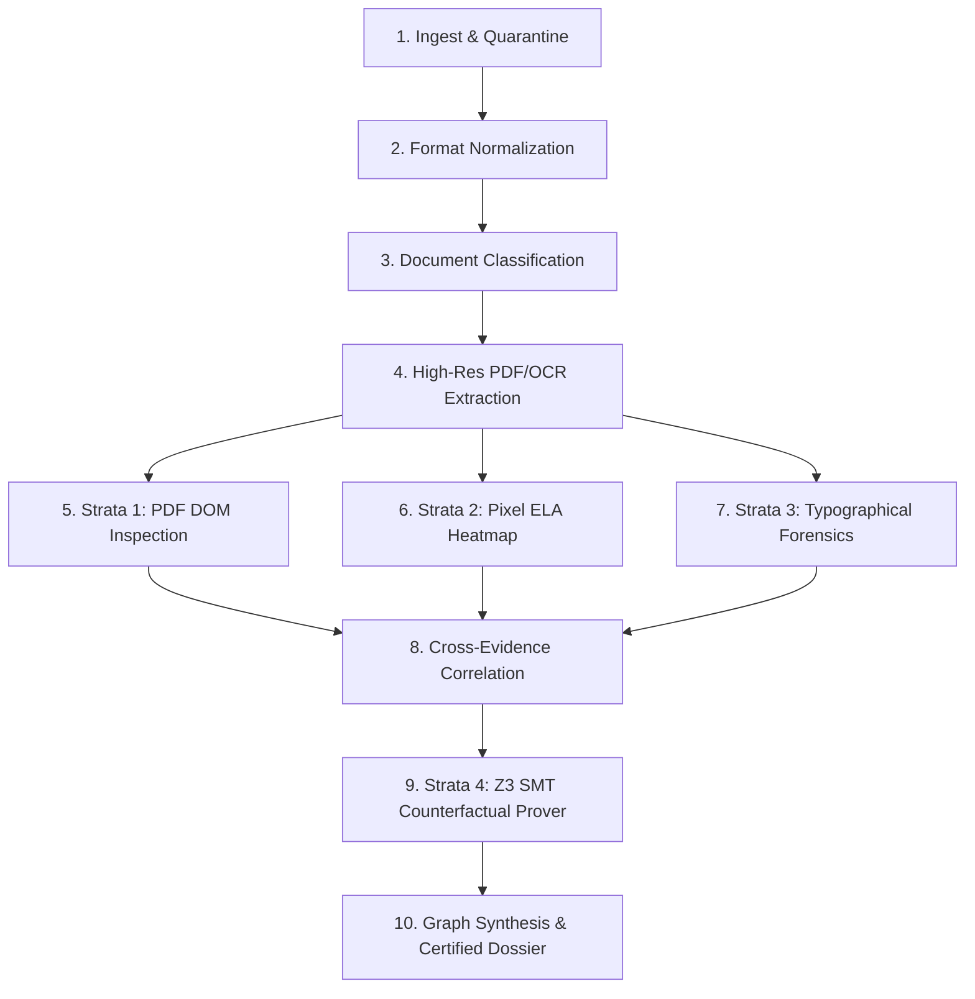
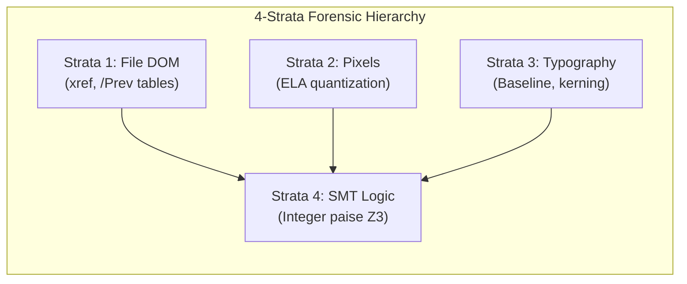
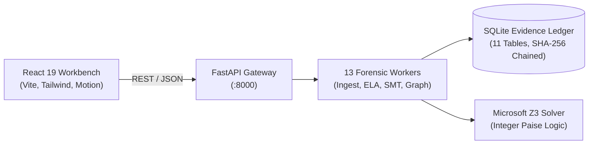

# VeriStrata CEIE — Counterfactual Evidence Investigation Engine

> **Don't guess if a document is fake. Prove it.**

[](https://www.python.org/)
[](https://fastapi.tiangolo.com/)
[](https://react.dev/)
[](https://github.com/Z3Prover/z3)
[](#running-tests)
[](LICENSE)

VeriStrata CEIE is a deterministic cross-document forensic investigation engine that replaces probabilistic AI guesses with 4-strata forensic telemetry, formal counterfactual logic, and ISO/IEC 27037 audit chains.

---

### Quick Links
[Demo Video (<ADD LINK>)](#getting-started) • [Presentation Slides (<ADD LINK>)](#) • [60-Second Demo](#60-second-demo) • [API Specification (docs/API.md)](docs/API.md) • [Technical Architecture (docs/ARCHITECTURE.md)](docs/ARCHITECTURE.md)

---

## 🛑 The Problem

Automated document analysis in lending and claims currently suffers from two fatal failure modes:

1. **False Positives on Split Payments:** Naive rules flag legitimate borrowers when payroll deposits are split across multiple bank credits (e.g. ₹65,000 net pay deposited as ₹40,000 + ₹25,000 over a weekend).
2. **Unverifiable Black-Box Scores:** Large language models hallucinate probability scores (e.g. *"87% suspicious"*) without providing spatial coordinates, mathematical proof, or forensic custody.

---

## 💡 Our Solution: Mathematical Restraint & Proof

VeriStrata evaluates claims against First-Order Logic constraints using the Microsoft Z3 SMT (Satisfiability Modulo Theories) solver. All monetary calculations use exact integer paise (1 INR = 100 paise) to eliminate floating-point rounding errors.

When claims appear inconsistent, VeriStrata formulates counterfactual hypotheses ($H_{split}$, $H_{delay}$, $H_{gross}$):
* **SAT (Satisfiable):** A valid operational hypothesis explains the data. The engine halts escalation and marks the case as an **`Observation`** (**Mathematical Restraint**).
* **UNSAT (Unsatisfiable):** No valid hypothesis satisfies the constraints. The engine proves the contradiction, isolates the minimal witness set, and escalates to **`Potential Manipulation`**.

| Evidence Bundle | Claimed Salary | Verified Bank Credits | Z3 SMT Outcome | Discrepancy Residual ($\Delta$) | Final Engine Status |
| :--- | :--- | :--- | :--- | :--- | :--- |
| **Clean Specimen** | ₹65,000.00 | ₹40,000.00 + ₹25,000.00 | **SAT** ($H_{split}$) | **₹0.00** (0 paise) | **Observation** |
| **Tampered Specimen** | ₹95,000.00 | ₹40,000.00 + ₹25,000.00 | **UNSAT** | **₹30,000.00** (3,000,000 paise) | **Potential Manipulation** |

---

## 📸 Screenshots & Interface Tour

Placeholders for interface screenshots located in `docs/screenshots/`:

| 5-Scene Autopsy Landing (`docs/screenshots/story_page.png`) | Unified Forensic Studio (`docs/screenshots/studio_workbench.png`) |
| :---: | :---: |
| *<TODO: Add screenshot of 3D tilted specimen & exploded strata>* | *<TODO: Add screenshot of 200 DPI canvas & precision loupe>* |
| **Contradiction Compare (`docs/screenshots/contradiction_compare.png`)** | **Certified Dossier (`docs/screenshots/dossier_export.png`)** |
| *<TODO: Add screenshot of caliper line proving 40k + 25k ≠ 95k>* | *<TODO: Add screenshot of ISO/IEC 27037 export with Merkle seal>* |

---

## ⚡ Key Features

| Forensic Detection Engine | Forensic Investigation Workbench |
| :--- | :--- |
| **PDF DOM Inspection:** Uncovers `/Prev` xref tables & object updates | **200 DPI Specimen Canvas:** Sub-pixel document pan and zoom |
| **Pixel Quantization:** Error Level Analysis (ELA) heatmap extraction | **Precision Loupe:** 300% circular magnifying loupe tracking the cursor |
| **Typographical Forensics:** Font baseline drops & glyph kerning deltas | **Contradiction Compare:** Dual split canvas with animated caliper line |
| **Z3 Counterfactual Prover:** Evaluates $H_{split}$, $H_{delay}$, $H_{gross}$ in integer paise | **Command Palette:** Keyboard-first (<kbd>Ctrl+K</kbd>) investigator navigation |
| **Bipartite Witness Graph:** Isolates minimal conflict coordinates | **In-App Autopilot:** Automated camera-directed tour with narration (<kbd>P</kbd>) |
| **Audit Provenance:** SHA-256 hash chaining aligned with ISO/IEC 27037 | **Certified Dossier Export:** 6-section PDF & JSON audit reports (<kbd>D</kbd>) |

---

## 🔬 How It Works

### The 10-Step Forensic Pipeline



### The 4 Forensic Strata



---

## 🏛️ System Architecture



Every review action appends an immutable record with previous-event SHA-256 hash chaining aligned with the principles of ISO/IEC 27037.

---

## 💻 Tech Stack

| Layer | Technologies |
| :--- | :--- |
| **Backend & Routing** | Python 3.12+, FastAPI, Uvicorn, aiosqlite, Pydantic v2 |
| **Formal Reasoning** | Microsoft Z3 Theorem Prover (`z3-solver`), Integer Paise Arithmetic |
| **Document Forensics** | PyMuPDF (`fitz`), pikepdf, OpenCV (`cv2`), Pillow, RapidFuzz |
| **Investigation Workbench** | React 19, TypeScript, Vite, Tailwind CSS v4, Motion, Lucide Icons |
| **Evidence & Dossiers** | NetworkX (Bipartite graphs), ReportLab (Certified PDF export) |
| **Testing & Quality** | pytest, pytest-asyncio, oxlint, custom unit assertion runner |

---

## 🚀 Getting Started

### Prerequisites
* Python 3.12 or newer
* Node.js 20 or newer (`npm`)
* Git

### 1. Clone & Set Up Backend

```bash
git clone https://github.com/aniketmehetre/VeriStrata-CEIE.git
cd VeriStrata-CEIE

# Create and activate virtual environment
python -m venv venv
# Windows:
.\venv\Scripts\activate
# macOS/Linux:
source venv/bin/activate

# Install dependencies
pip install -r backend/requirements.txt
```

### 2. Set Up Frontend

```bash
cd frontend
npm install
cd ..
```

### 3. Run the Servers

Start the backend (Terminal 1):
```bash
python -m uvicorn app.main:app --host 127.0.0.1 --port 8000 --app-dir backend
```

Start the frontend (Terminal 2):
```bash
cd frontend
npm run dev
```

* Frontend Workbench: `http://127.0.0.1:5173` (Studio at `http://127.0.0.1:5173/#/studio`)
* Backend API & OpenAPI Docs: `http://127.0.0.1:8000/docs`

---

## ⏱️ 60-Second Demo

You can run the entire end-to-end pipeline with one command:

```bash
python demo.py
```

This ingests the synthetic loan bundle, executes all 4 forensic strata, runs Z3 theorem proving, records an ISO/IEC 27037 audit hash, exports the PDF dossier to `data/dossiers/`, and automatically opens the interactive workbench in your browser.

<details>
<summary>Manual Click-Through in the Workbench</summary>

1. Open `http://127.0.0.1:5173/#/studio`.
2. Hover over the Net Pay field (`₹95,000.00`) to activate the 200 DPI Precision Loupe.
3. Press <kbd>C</kbd> to activate **Contradiction Compare Mode** and view the animated caliper line.
4. Press <kbd>D</kbd> to inspect the Merkle audit trail and export the certified dossier.
5. Press <kbd>P</kbd> to run the automated in-app camera walkthrough.
</details>

---

## 🧪 Running Tests

All unit and integration tests are verified and passing:

```bash
# Backend tests (4 passed)
python -m pytest backend

# Frontend unit tests (100% green)
cd frontend && npm test
```

Expected output:
```text
backend/tests/test_e2e.py ....                                           [100%]
============================== 4 passed in 4.90s ==============================

✓ bboxToCss passed all test cases
✓ formatPaise passed integer paise conversion tests
✓ statusStyles passed compile-time & runtime exhaustiveness tests
ALL UNIT TESTS PASSED SUCCESSFULLY! (100% GREEN)
```

---

## 🔌 API Overview

The backend exposes 23 routes (28 HTTP operations). See [docs/API.md](docs/API.md) for the complete endpoint specification.

| Method | Endpoint | Description |
| :--- | :--- | :--- |
| `GET` | `/health` | System health check (DB, OCR, Z3 SMT solver) |
| `POST` | `/api/cases/demo` | Seeds and executes a full demo case (`clean` or `tampered`) |
| `POST` | `/api/cases/{case_id}/analyze` | Triggers the 10-step asynchronous forensic pipeline |
| `GET` | `/api/cases/{case_id}/claims` | Retrieves extracted claims with normalized integer paise values |
| `GET` | `/api/cases/{case_id}/hypotheses` | Z3 SMT hypothesis test results ($H_{split}$, $H_{delay}$, $H_{gross}$) |
| `GET` | `/api/cases/{case_id}/graph` | NetworkX bipartite contradiction and evidence graph |
| `POST` | `/api/findings/{finding_id}/review` | Records human review decisions with ISO/IEC 27037 hash chaining |
| `GET` | `/api/cases/{case_id}/dossier` | Generates certified investigation dossier (`format=pdf` or `json`) |
| `GET` | `/report/{case_id}` | Standalone server-rendered HTML forensic report |

---

## 📁 Project Structure

```text
VeriStrata-CEIE/
├── backend/                  # FastAPI service & forensic workers
│   ├── app/
│   │   ├── main.py           # Application entry point & lifespan handler
│   │   ├── db.py             # SQLite ledger schema (11 tables)
│   │   ├── routers/          # 6 API routers (cases, claims, docs, findings, dossier, workbench)
│   │   └── workers/          # 13 forensic workers (ELA, DOM, Z3 hypotheses, graph, dossier)
│   └── tests/                # Automated pytest test suites
├── data/
│   ├── synthetic/            # Clean and tampered demonstration PDF bundles
│   └── dossiers/             # Exported ISO/IEC 27037 PDF & JSON dossiers
├── docs/                     # Deep documentation, API specifications, and walk-through scripts
│   ├── API.md                # Comprehensive endpoint specification
│   ├── ARCHITECTURE.md       # 4-Strata hierarchy and Z3 hypothesis formal math
│   └── CRAZY_FRONTEND_WALKTHROUGH_SCRIPT.md # 2.5-minute stage pitch script
├── frontend/                 # React 19 forensic investigation workbench
│   └── src/
│       ├── story/            # 5-scene autopsy storyline experience
│       ├── workbench/        # 15 unified darkroom components (HUD, canvas, loupe, caliper)
│       └── ui/               # Command palette, keyboard controls, and Guided Autopilot
└── demo.py                   # Automated end-to-end demonstration runner
```

---

## 📋 PS-2 Requirements Mapping

| Evaluation Area | Implementation Details | Source Files |
| :--- | :--- | :--- |
| **File Forensics** | PDF trailer inspection, `/Prev` xref tables, and unreferenced fonts | [`forensics_structural.py`](backend/app/workers/forensics_structural.py) |
| **Pixel Forensics** | JPEG Error Level Analysis (ELA) and quantization deltas | [`forensics_pixel.py`](backend/app/workers/forensics_pixel.py) |
| **Typographical Geometry** | Font baseline alignment, glyph spacing, and inline font substitution | [`rules_intra.py`](backend/app/workers/rules_intra.py) |
| **Contextual Intelligence** | Microsoft Z3 SMT counterfactual reasoning in integer paise | [`hypothesis.py`](backend/app/workers/hypothesis.py) |
| **Cross-Evidence Graph** | NetworkX bipartite contradiction graph mapping claims to bounds | [`correlation.py`](backend/app/workers/correlation.py), [`graph.py`](backend/app/workers/graph.py) |
| **Audit Compliance** | SHA-256 hash chaining aligned with the principles of ISO/IEC 27037 | [`audit.py`](backend/app/utils/audit.py), [`dossier.py`](backend/app/workers/dossier.py) |
| **Investigation UI** | Palantir-style 200 DPI darkroom workbench with precision loupe | [`frontend/src/workbench/`](frontend/src/workbench/) |

---

## ⚖️ Limitations & Future Scope

### Current Limitations
* OCR extraction assumes English alphanumeric characters and standard Indian financial formats.
* Complex scanned document distortions (e.g. physical paper crumpling) require flatbed scan quality for reliable pixel ELA.

### Future Scope
* Expansion to multi-lingual regional document templates (Hindi, Marathi, Tamil).
* Hardware-accelerated GPU pipeline for batch processing thousands of loan applications concurrently.

---

## 🔒 Ethics & Data Integrity

* **Synthetic Data Only:** All demonstration documents and identity records are purely synthetic. No real PII is stored.
* **Human-in-the-Loop:** VeriStrata enforces human reviewer oversight. The system provides formal evidence; authorized auditors make final legal decisions.
* **Deterministic Proofs:** Replacing black-box generative AI prompts with Z3 formal theorem proving eliminates hallucinations and algorithmic bias.

---

## 👥 Team & License

**Team void main** — Vishwakarma Institute of Technology, Pune  
* **Aniket Mehetre**
* **Amogh**

Developed for the **DataOps Innovation Hackathon 2026** (Problem Statement 2: AI-Powered Document Forensics and Contextual Intelligence System).

This project is licensed under the **Apache License 2.0**. See the [LICENSE](LICENSE) file for details.

### Acknowledgements
Built using [Microsoft Z3](https://github.com/Z3Prover/z3), [FastAPI](https://fastapi.tiangolo.com/), [PyMuPDF](https://pymupdf.readthedocs.io/), [pikepdf](https://pikepdf.readthedocs.io/), [OpenCV](https://opencv.org/), [React](https://react.dev/), and [Tailwind CSS](https://tailwindcss.com/).
