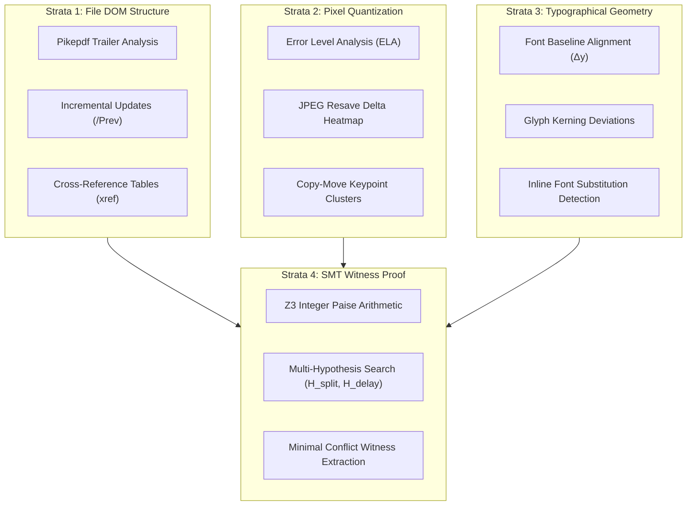

# VeriStrata CEIE — Deep Technical Architecture

## 1. 4-Strata Forensic Hierarchy

VeriStrata investigates incoming loan evidence bundles through four complementary, orthogonal forensic strata:

---

## 2. Formal Hypothesis Evaluation with Z3 SMT

Conventional automated systems fail because they treat discrepancies as binary errors. In banking and payroll workflows, legitimate operational variations (e.g., weekend processing, split payments, taxes) create apparent mismatches.

VeriStrata applies **Counterfactual Hypothesis Evaluation** using the Microsoft Z3 SMT Theorem Prover.

### Integer Paise Representation
To eliminate floating-point representation artifacts inherent in IEEE 754 arithmetic (e.g. `0.1 + 0.2 != 0.3`), all monetary values are mapped to exact integer paise:
$$\text{paise} = \text{round}(\text{amount} \times 100) \in \mathbb{Z}$$

### Hypotheses Formulated:
1. **$H_{\text{split}}$ (Split Payroll Credits):**  
   Searches for a subset of bank credit transactions $S \subseteq \text{Credits}$ within a temporal window $W$ whose sum matches the declared net pay $P$:
   $$\sum_{c \in S} \text{amount}(c) = P$$
2. **$H_{\text{delay}}$ (Calendar Posting Delays):**  
   Evaluates transactions within an expanded $\pm 7$ to $\pm 14$ day window to account for national holidays and banking clearance cycles.
3. **$H_{\text{gross}}$ (Gross vs. Net Pay Confusion):**  
   Reconciles employer gross salary declarations against net pay after statutory deductions (TDS, PF).

### Decision Logic:
- If any hypothesis yields **SAT** (Satisfiable), the discrepancy is fully explained. Escalation is halted, and the finding is classified as an **`Observation`** (**Mathematical Restraint**).
- If all hypotheses yield **UNSAT** (Unsatisfiable), the system proves an irreconcilable contradiction, isolates the minimal witness set, and calculates the exact monetary residual gap:
  $$\Delta = P - \sum_{c \in S^*} \text{amount}(c)$$
  The finding escalates to **`Potential Manipulation`**.

---

## 3. Cryptographic Audit Provenance (ISO/IEC 27037)

Every forensic extraction, signal evaluation, and human reviewer action is appended to an immutable SQLite ledger with SHA-256 hash chaining:

$$H_i = \text{SHA-256}(\text{EventID}_i \parallel \text{Action}_i \parallel \text{Reason}_i \parallel \text{Timestamp}_i \parallel H_{i-1})$$

Retroactive modification of any historical review event invalidates all downstream hash chains, guaranteeing verifiable provenance.

