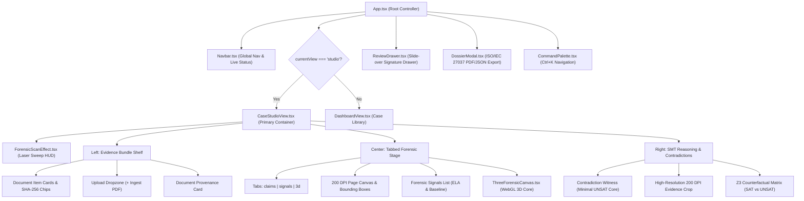
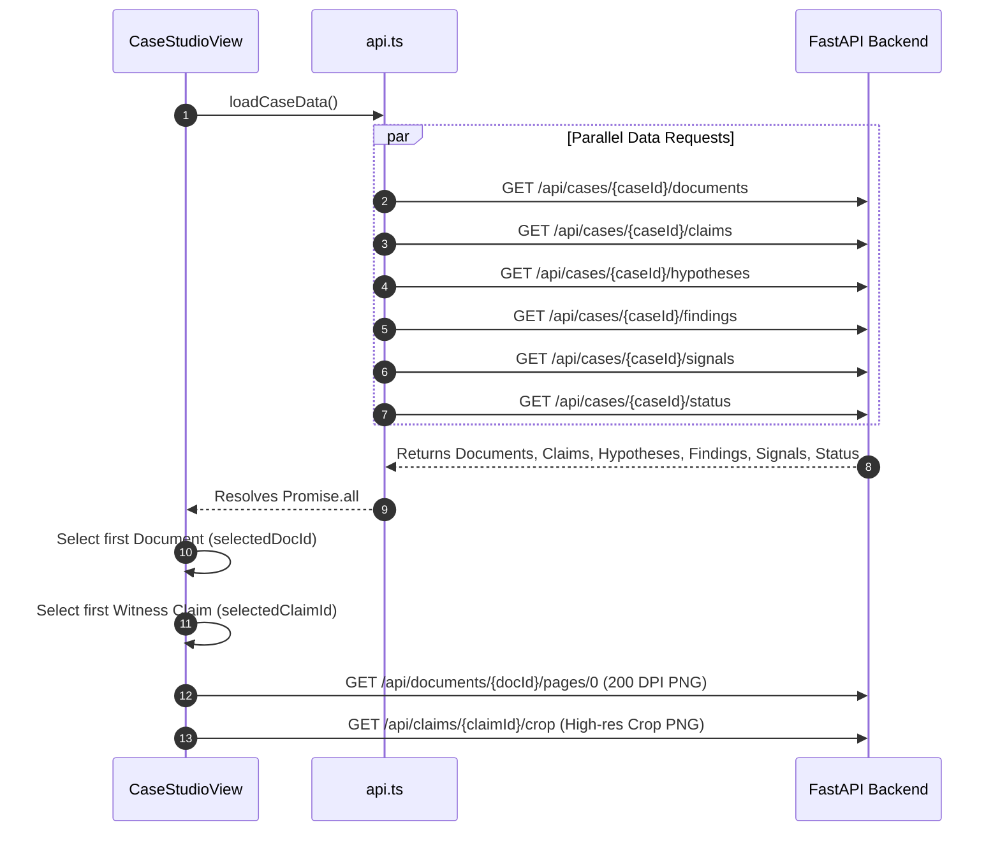

# VeriStrata CEIE — Forensic Investigation Workbench UI Architecture & LLM Redesign Guide

> **Document Status:** Complete Architecture & Implementation Reference  
> **Target Audience:** Frontend Engineers, UI/UX Designers, and AI Coding Models (LLMs) tasked with maintaining, restyling, or overhauling the Forensic Investigation Workbench interface.  
> **Primary Components:** [`CaseStudioView.tsx`](file:///C:/HACKATHONS/Data-ops/frontend/src/components/CaseStudioView.tsx), [`StudioScene.tsx`](file:///C:/HACKATHONS/Data-ops/frontend/src/story/scenes/StudioScene.tsx), [`ReviewDrawer.tsx`](file:///C:/HACKATHONS/Data-ops/frontend/src/components/ReviewDrawer.tsx), [`ThreeForensicCanvas.tsx`](file:///C:/HACKATHONS/Data-ops/frontend/src/components/ThreeForensicCanvas.tsx), [`DossierModal.tsx`](file:///C:/HACKATHONS/Data-ops/frontend/src/components/DossierModal.tsx)

---

## Table of Contents
1. [Executive Overview & Design Philosophy](#1-executive-overview--design-philosophy)
2. [Source Code Anatomy & File Map](#2-source-code-anatomy--file-map)
3. [Routing, Navigation & Application Entry Points](#3-routing-navigation--application-entry-points)
4. [Component Hierarchy & Data Flow](#4-component-hierarchy--data-flow)
5. [Exhaustive State Management Blueprint](#5-exhaustive-state-management-blueprint)
6. [The 3-Column Grid Layout Breakdown](#6-the-3-column-grid-layout-breakdown)
7. [Coordinate Systems, Document Rendering & Loupe Magnification](#7-coordinate-systems-document-rendering--loupe-magnification)
8. [WebGL & Three.js 3D Visualizer (`ThreeForensicCanvas.tsx`)](#8-webgl--threejs-3d-visualizer-threeforensiccanvastsx)
9. [Review Drawer & Cryptographic Audit Flow (`ReviewDrawer.tsx`)](#9-review-drawer--cryptographic-audit-flow-reviewdrawertsx)
10. [Design System, Typography, Colors & CSS Tokens](#10-design-system-typography-colors--css-tokens)
11. [Backend REST API Contract for the Workbench](#11-backend-rest-api-contract-for-the-workbench)
12. [Complete LLM Guide: How to Redesign or Modify the Workbench UI](#12-complete-llm-guide-how-to-redesign-or-modify-the-workbench-ui)

---

## 1. Executive Overview & Design Philosophy

The **Forensic Investigation Workbench** is the operational nerve center of **VeriStrata CEIE** (*Counterfactual Evidence Investigation Engine*). Its goal is to allow forensic examiners, fraud auditors, and legal compliance officers to inspect loan and payroll evidence bundles with absolute cryptographic and mathematical clarity.

### The "Autopsy Table" Metaphor
Unlike standard administrative dashboards with cards and generic tables, the Workbench is designed around the metaphor of a **clean-room digital forensic autopsy table**:
1. **Mathematical Restraint First:** If a discrepancy can be resolved by legitimate explanations (e.g., split payroll deposits, bank posting lag, or tax deductions), the system marks the case as an `Observation` with $\Delta = \text{INR } 0.00$ residual.
2. **Escalation Only on UNSAT:** Only when every conceivable counterfactual permutation fails does the system escalate to `Potential Manipulation`, highlighting the minimal witness core and residual gap.
3. **Multi-Strata Fusion:** A claim is not just a row in a database; it is visually linked to:
   - Its exact 200 DPI rendered pixel coordinate on the source PDF.
   - Its cryptographic SHA-256 document checksum.
   - Its pixel-level Error Level Analysis (ELA) and typographical anomalies.
   - Its Z3 SMT constraint satisfiability outcome.
4. **Dual Representation in Frontend:**
   - **Scene 04 (`StudioScene.tsx`):** A high-impact, curated interactive autopsy stage embedded inside the cinematic scroll-story (`#/`).
   - **Full Studio (`CaseStudioView.tsx`):** The fully functional, production-ready, multi-document investigative application accessible at `#/studio`.

```
+-----------------------------------------------------------------------------------------+
|                                    TOP HUD & STATUS BAR                                  |
| Breadcrumb · Case ID · Status Pill (Observation / Manipulation) · Pipeline Status · Actions|
+---------------------------+-------------------------------+-----------------------------+
|    LEFT COLUMN (3 cols)   |     CENTER STAGE (5 cols)     |    RIGHT COLUMN (4 cols)    |
|                           |                               |                             |
| • Evidence Shelf (Files)  | • Tab: Document Claims        | • Contradiction Witness Set |
| • Document Provenance     |   - 200 DPI Rendered Specimen | • Minimal UNSAT Core        |
|   - MIME, Pages, Conf     |   - Bounding Box Highlights   | • Arithmetic Discrepancy    |
|   - SHA-256 Copy Chip     | • Tab: Forensic Signals (ELA) | • 200 DPI Image Crop Preview|
| • "+ Ingest PDF" Dropzone | • Tab: 3D Evidence WebGL Core | • Z3 Counterfactual Matrix  |
+---------------------------+-------------------------------+-----------------------------+
|                                  CRYPTOGRAPHIC AUDIT CHAIN                              |
+-----------------------------------------------------------------------------------------+
```

---

## 2. Source Code Anatomy & File Map

All files governing the Workbench frontend reside in `frontend/src`:

| File Path | Role & Description | Primary Export |
| :--- | :--- | :--- |
| [`frontend/src/components/CaseStudioView.tsx`](file:///C:/HACKATHONS/Data-ops/frontend/src/components/CaseStudioView.tsx) | **Core Workbench Container.** Houses the 3-column layout, state orchestration, document selection, tab switching, and claim hover logic. | `CaseStudioView` |
| [`frontend/src/story/scenes/StudioScene.tsx`](file:///C:/HACKATHONS/Data-ops/frontend/src/story/scenes/StudioScene.tsx) | **Scene 04 Story Preview.** Embedded interactive specimen with live 200 DPI Precision Loupe magnifier and layer toggle buttons. | `StudioScene` |
| [`frontend/src/components/ReviewDrawer.tsx`](file:///C:/HACKATHONS/Data-ops/frontend/src/components/ReviewDrawer.tsx) | **Investigator Sign & Stamp Drawer.** Slide-out modal with `motion/react` animation, confetti burst, and audit trail chaining. | `ReviewDrawer` |
| [`frontend/src/components/DossierModal.tsx`](file:///C:/HACKATHONS/Data-ops/frontend/src/components/DossierModal.tsx) | **Court Dossier Export Dialog.** Previews and downloads court-admissible JSON and PDF dossiers adhering to ISO/IEC 27037. | `DossierModal` |
| [`frontend/src/components/ThreeForensicCanvas.tsx`](file:///C:/HACKATHONS/Data-ops/frontend/src/components/ThreeForensicCanvas.tsx) | **Three.js 3D WebGL Canvas.** Renders real-time interactive geometric lattice and SMT constraint cores with dynamic ruby/cyan lighting. | `ThreeForensicCanvas` |
| [`frontend/src/components/ForensicScanEffect.tsx`](file:///C:/HACKATHONS/Data-ops/frontend/src/components/ForensicScanEffect.tsx) | **Laser Scanline Overlay.** Animated holographic horizontal scanning bar triggered while the backend analysis pipeline runs. | `ForensicScanline` |
| [`frontend/src/types.ts`](file:///C:/HACKATHONS/Data-ops/frontend/src/types.ts) | **TypeScript Type Definitions.** Defines `Case`, `DocumentItem`, `Claim`, `Signal`, `Hypothesis`, `Finding`, and `ReviewEvent`. | Multiple interfaces |
| [`frontend/src/api.ts`](file:///C:/HACKATHONS/Data-ops/frontend/src/api.ts) | **REST API Client.** Implements all fetch helpers connecting the React UI to FastAPI backend endpoints. | Multiple functions |
| [`frontend/src/index.css`](file:///C:/HACKATHONS/Data-ops/frontend/src/index.css) | **Tailwind v4 Theme & Custom CSS.** Defines design tokens, autopsy hairlines grid, laser animations, and custom scrollbars. | CSS variables & rules |

---

## 3. Routing, Navigation & Application Entry Points

The frontend employs hash-based routing (`window.location.hash`) inside [`App.tsx`](file:///C:/HACKATHONS/Data-ops/frontend/src/App.tsx):

1. **`#/` (Root Story):** Cinematic 5-scene autopsy scroll experience powered by [Lenis](https://github.com/darkroomengineering/lenis). Scene 04 embeds [`StudioScene.tsx`](file:///C:/HACKATHONS/Data-ops/frontend/src/story/scenes/StudioScene.tsx).
2. **`#/studio` (Investigation Studio):** The dedicated operational workbench. Renders [`CaseStudioView.tsx`](file:///C:/HACKATHONS/Data-ops/frontend/src/components/CaseStudioView.tsx) directly under the global navbar.
3. **`#/styleguide` (Design System):** Live tokens, button variants, chips, typography scales, and paper sheet components.

### Global Command Palette (`Ctrl+K` / `Cmd+K`)
Users and automated testers can trigger any workbench action via [`CommandPalette.tsx`](file:///C:/HACKATHONS/Data-ops/frontend/src/ui/vendor/CommandPalette.tsx):
- `S`: Open Full Investigation Studio (`#/studio`)
- `C`: Run Clean Bundle Demo (Demonstration of Mathematical Restraint)
- `T`: Run Tampered Bundle Demo (Demonstration of Escalation)
- `D`: Export Court Investigation Dossier (PDF & JSON)
- `4`: Scroll directly to Scene 04 Forensic Workbench in the story

---

## 4. Component Hierarchy & Data Flow

### Visual Tree


### Initial Data Load Sequence
When [`CaseStudioView.tsx`](file:///C:/HACKATHONS/Data-ops/frontend/src/components/CaseStudioView.tsx) mounts for a selected case:


---

## 5. Exhaustive State Management Blueprint

Every piece of interactive state in [`CaseStudioView.tsx`](file:///C:/HACKATHONS/Data-ops/frontend/src/components/CaseStudioView.tsx) is strictly typed:

### Primary React State Variables
```typescript
// Case data entities loaded from backend
const [documents, setDocuments] = useState<DocumentItem[]>([]);
const [selectedDocId, setSelectedDocId] = useState<string>('');
const [claims, setClaims] = useState<Claim[]>([]);
const [hypotheses, setHypotheses] = useState<Hypothesis[]>([]);
const [findings, setFindings] = useState<Finding[]>([]);
const [signals, setSignals] = useState<Signal[]>([]);
const [statusInfo, setStatusInfo] = useState<CaseStatus | null>(null);

// Interactive UI tab & selection state
const [activeTab, setActiveTab] = useState<'claims' | 'signals' | '3d'>('claims');
const [selectedClaimId, setSelectedClaimId] = useState<string | null>(null);
const [hoveredClaimId, setHoveredClaimId] = useState<string | null>(null);

// Async network loading states
const [analyzing, setAnalyzing] = useState<boolean>(false);
const [uploading, setUploading] = useState<boolean>(false);
const [copiedHash, setCopiedHash] = useState<boolean>(false);
```

### Derived Computation Values
These values are computed synchronously on every render without unnecessary extra re-renders:
- `activeDoc`: Finds the currently selected document object from `documents`.
- `activeDocClaims`: Filtered array of claims where `claim.document_id === selectedDocId`.
- `activeDocSignals`: Filtered array of signals where `signal.document_id === selectedDocId`.
- `primaryFinding`: `findings[0]` — the highest-priority forensic conclusion for this case.
- `isEscalated`: Boolean flag indicating `primaryFinding.status === 'potential_manipulation'`.
- `isInconsistency`: Boolean flag indicating `primaryFinding.status === 'inconsistency'`.
- `maxResidual`: The maximum unresolved monetary gap ($\Delta$) among all tested hypotheses (e.g. `INR 30,000.00`).
- `witnessClaims`: Filtered array of claims whose IDs match `primaryFinding.witness_claim_ids`.

---

## 6. The 3-Column Grid Layout Breakdown

The main stage is structured as an asymmetrical 12-column responsive CSS grid:
```tsx
<div className="grid grid-cols-1 lg:grid-cols-12 gap-6 items-start">
  {/* Column 1: Left Shelf (3 cols) */}
  <div className="lg:col-span-3 space-y-4"> ... </div>

  {/* Column 2: Center Stage (5 cols) */}
  <div className="lg:col-span-5 space-y-4"> ... </div>

  {/* Column 3: Right Inspector (4 cols) */}
  <div className="lg:col-span-4 space-y-4"> ... </div>
</div>
```

---

### Column 1: Left Shelf (`lg:col-span-3`) — Evidence Bundle & Provenance

1. **Evidence Bundle Header:** Shows file count badge (`N Files`).
2. **Document Scroll Area (`max-h-[460px] overflow-y-auto`):**
   - Renders each document card.
   - Highlights the active file with a glowing border (`border-cyan-500/60 bg-cyan-950/50`).
   - Displays classification tag (e.g. `SALARY_SLIP`, `BANK_STATEMENT`, `APPLICATION_FORM`).
   - Displays claim count and SHA-256 abbreviation (e.g. `SHA: 88d7374d...`).
   - Displays amber badge if `signals` are detected on this specific file.
3. **"+ Ingest PDF to Bundle" Dropzone:**
   - Hidden file input accepting `.pdf`.
   - On change, calls `uploadDocuments(caseId, files)` then immediately triggers `handleAnalyze()` to re-execute OCR, extraction, and SMT solving.
4. **Active Document Provenance Card:**
   - Displays MIME type (`application/pdf`).
   - Displays page count.
   - Displays document classifier confidence percentage (`activeDoc.classification_confidence * 100`).
   - Displays full 64-character SHA-256 checksum with an instant **Copy to Clipboard** button.

---

### Column 2: Center Stage (`lg:col-span-5`) — Multi-Strata Inspection

1. **Stage Navigation Tabs:**
   - `Document Claims (N)`: Active inspection of rendered 200 DPI pages with bounding boxes.
   - `Forensic Signals (N)`: Pixel and structural anomalies (ELA deltas, copy-move clusters, font baseline shifts).
   - `3D Evidence Core`: Three.js WebGL spatial visualization.
2. **Claims Tab (Rendered 200 DPI Page Image):**
   - High-resolution document image loaded via `getDocumentPageUrl(docId, 0)`.
   - Interactive SVG/HTML bounding box overlays computed from `bbox_norm` (see Section 7).
   - Hovering or clicking a bounding box synchronizes `selectedClaimId` across all columns.
3. **Forensic Signals Tab:**
   - Lists pixel and typography detectors.
   - Displays severity tag (`low`, `medium`, `high`) and numeric score.
   - Shows raw detector metadata (e.g., detected font substitutions, baseline jitter in points, ELA average delta).
4. **3D Evidence Core Tab:**
   - Mounts [`ThreeForensicCanvas.tsx`](file:///C:/HACKATHONS/Data-ops/frontend/src/components/ThreeForensicCanvas.tsx).
   - If `isEscalated` is true, automatically switches to red anomaly mode with warning particles.

---

### Column 3: Right Column (`lg:col-span-4`) — Contradiction Witness & Z3 Matrix

1. **Contradiction Witness Panel (Minimal UNSAT Core):**
   - When an UNSAT conflict exists, displays the contradictory claims side-by-side (e.g., Salary Slip `₹95,000` vs Bank Credit `₹65,000`).
   - Clicking any witness claim automatically focuses that claim and updates the crop preview.
2. **Arithmetic Discrepancy Callout:**
   - Prominently displays the exact unresolved residual (e.g., `INR 30,000.00`).
   - Explains that no permutation of split payroll, tax withholding, or calendar posting delays satisfies constraints.
3. **200 DPI Native Crop Preview:**
   - Fetches the exact high-resolution PNG crop from `/api/claims/{claimId}/crop`.
   - Displays field name, extracted text, and extractor engine (e.g., `pdf_text_parser`, `tesseract_ocr`).
4. **Z3 Counterfactual Matrix:**
   - Lists all evaluated hypotheses ($H_{\text{split}}$, $H_{\text{delay}}$, $H_{\text{gross}}$).
   - Shows status pill: `SUPPORTED` (green) or `REJECTED` (rose).
   - Displays the formal SMT theorem explanation and residual conflict.

---

## 7. Coordinate Systems, Document Rendering & Loupe Magnification

### Normalized Bounding Box Format
All document coordinates in VeriStrata CEIE are normalized floats between `0.0` and `1.0`:
$$\text{bbox\_norm} = [x_0, y_0, x_1, y_1]$$
- $x_0$: Left edge ratio ($0.0 = \text{left margin}, 1.0 = \text{right margin}$)
- $y_0$: Top edge ratio ($0.0 = \text{top margin}, 1.0 = \text{bottom margin}$)
- $x_1$: Right edge ratio
- $y_1$: Bottom edge ratio

### CSS Percentage Conversion
In [`CaseStudioView.tsx`](file:///C:/HACKATHONS/Data-ops/frontend/src/components/CaseStudioView.tsx#L479-L483), normalized coordinates are translated into CSS styling:
```typescript
const [x0, y0, x1, y1] = claim.bbox_norm;
const left = `${x0 * 100}%`;
const top = `${y0 * 100}%`;
const width = `${(x1 - x0) * 100}%`;
const height = `${(y1 - y0) * 100}%`;
```
This guarantees that regardless of screen resolution, viewport width, or CSS scaling, the bounding box aligns precisely with the rendered 200 DPI page image.

### Bounding Box Visual States
- **Normal Claim:** Border cyan (`border-cyan-400/40`), subtle background (`bg-cyan-500/10`).
- **Selected or Hovered:** Bright cyan glow (`border-2 border-cyan-400 bg-cyan-500/30 shadow-[0_0_12px_rgba(6,182,212,0.6)]`).
- **Contradiction Witness:** Pulsing ruby alert (`border-2 border-rose-400 bg-rose-500/25 animate-pulse shadow-[0_0_12px_rgba(244,63,94,0.6)]`).

### Precision Loupe Magnifier (in `StudioScene.tsx`)
In the Scene 04 preview, the Precision Loupe floats over the specimen:
```tsx
<div className="absolute right-4 top-4 w-44 h-44 rounded-full border-2 border-[#5ce1e6] bg-[#0e1218]/95 shadow-[0_0_30px_rgba(92,225,230,0.3)] p-3 flex flex-col justify-between items-center text-center z-30">
  <span className="font-mono text-[9px] font-bold text-[#5ce1e6] tracking-wider uppercase">
    PRECISION LOUPE 200 DPI
  </span>
  <div className="text-2xl font-bold italic text-[#ff4d6a]" style={{ fontFamily: 'Georgia, serif' }}>
    ₹95,000
  </div>
  <div className="font-mono text-[8px] text-[#8e98a6] leading-tight">
    GLYPH RUN ≠ BASELINE<br />
    FONT OBJECT: Georgia-Italic
  </div>
</div>
```
When restructuring the full studio, this Loupe pattern can be made dynamic by tracking mouse cursor coordinates over the main ``.

---

## 8. WebGL & Three.js 3D Visualizer (`ThreeForensicCanvas.tsx`)

The Workbench includes a dedicated WebGL canvas powered by Three.js:
- **Geometry Core:** Central icosahedron (`IcosahedronGeometry(1.2, 1)`) surrounded by a wireframe cage (`IcosahedronGeometry(1.28, 2)`).
- **Particle System:** 240 particles orbiting in a spherical cloud (`THREE.Points`).
- **Orbital Torus Rings:** Multi-axis rings representing constraint boundaries.
- **Dynamic Mode Colors:**
  - `smt` mode: Neon Cyan (`#00f0ff`) and Royal Blue (`#3b82f6`).
  - `anomaly` mode: Ruby Red (`#f43f5e`) and Warning Amber (`#fbbf24`).
  - `lattice` mode: Emerald (`#10b981`) and Cyan (`#06b6d4`).
- **Cleanup Guarantee:** Correctly disposes geometries, materials, and cancels animation frame handles when unmounting or switching tabs.

---

## 9. Review Drawer & Cryptographic Audit Flow (`ReviewDrawer.tsx`)

The Review Drawer implements human-in-the-loop review adhering to ISO/IEC 27037 standards:
1. **Slide-Over Animation:** Powered by `motion/react` spring physics (`damping: 26, stiffness: 220`).
2. **Three Review Actions:**
   - `accept`: Confirms manipulation / forgery.
   - `dismiss`: Exercises mathematical restraint; marks finding as benign or explained. **Requires mandatory written justification in the reason field.**
   - `annotate`: Attaches notes without changing status.
3. **Cryptographic Chaining:**
   Every review submission writes to the backend audit log, appending the investigator's name, action, timestamp, and the SHA-256 hash of the previous event:
   $$\text{Hash}_i = \text{SHA256}(\text{EventID} \parallel \text{Action} \parallel \text{Timestamp} \parallel \text{Reason} \parallel \text{Hash}_{i-1})$$
4. **Reward Feedback:** On successful submission, triggers a confetti explosion (`canvas-confetti`) with cyan, emerald, and white particles.

---

## 10. Design System, Typography, Colors & CSS Tokens

VeriStrata CEIE utilizes **Tailwind CSS v4** with token definitions in [`frontend/src/index.css`](file:///C:/HACKATHONS/Data-ops/frontend/src/index.css):

### Color Tokens
```css
@theme {
  --color-ground: #07090c;         /* Darkest Obsidian Autopsy Background */
  --color-panel: #0e1218;          /* Standard Frosted Glass Panel */
  --color-panel-2: #151b24;        /* Elevated Element / Card Background */
  --color-line: #1f2733;           /* Hairline Border */
  --color-line-strong: #3a4757;    /* Focus & Active Border */
  --color-text: #e8e6df;           /* Primary Off-White Text */
  --color-muted: #aab4c2;          /* Secondary Body Text */
  --color-dim: #8e98a6;            /* Metadata & Label Dim Text */
  --color-paper: #e9e4d4;          /* Realistic Specimen Document Paper Background */
  --color-ink: #14120d;            /* Specimen Ink Text */
  
  /* Semantic Status Colors */
  --color-lime: #c6f432;           /* Verified / Mathematical Restraint / Merkle Pass */
  --color-ruby: #ff4d6a;           /* Contradiction / UNSAT / Potential Manipulation */
  --color-ruby-text: #ff8da0;      /* Legible Ruby Text */
  --color-cyan: #5ce1e6;           /* Telemetry, Active Selection, Coordinates */
  --color-amber: #f5a524;          /* Non-Fatal Inconsistency Warning */
}
```

### Font Pairings
- **Sans (`--font-sans`):** `'Inter Tight', system-ui, -apple-system, sans-serif` — Used for controls, labels, and readable body text.
- **Monospace (`--font-mono`):** `'JetBrains Mono', ui-monospace, monospace` — Used for SHA-256 hashes, monetary amounts (with `tabular-nums`), coordinates, and kicker labels.
- **Serif (`--font-serif`):** `'Instrument Serif', Georgia, serif` — Used for high-impact residual numbers and court certificate headings.

### Core Utility Classes
- `.autopsy-grid`: 80px hairline grid pattern overlay.
- `.kicker`: Uppercase, tracking-widest monospace section tag (`11px`, `letter-spacing: 0.14em`).
- `.glass-panel`: Frosted backdrop (`backdrop-blur-md bg-[#0e1218]/90 border border-[#1f2733]`).
- `.glass-panel-ruby`: Alert backdrop (`bg-[#ff4d6a]/8 border border-[#ff4d6a]/30`).
- `.animate-laser`: Horizontal sweeping laser bar animation.

---

## 11. Backend REST API Contract for the Workbench

All frontend interactions in `CaseStudioView` bind directly to these FastAPI endpoints:

| Endpoint URL | HTTP Method | Request Payload | Response Schema | UI Consumer in Workbench |
| :--- | :--- | :--- | :--- | :--- |
| `/api/cases/{id}/documents` | `GET` | None | `DocumentItem[]` | Evidence Bundle Shelf (Left col) |
| `/api/cases/{id}/documents` | `POST` | `multipart/form-data` (`files`) | `DocumentItem[]` | "+ Ingest PDF to Bundle" dropzone |
| `/api/cases/{id}/claims` | `GET` | None | `Claim[]` | Center Stage Bounding Boxes & Witness Panel |
| `/api/cases/{id}/hypotheses` | `GET` | None | `Hypothesis[]` | Z3 Counterfactual Matrix (Right col) |
| `/api/cases/{id}/findings` | `GET` | None | `Finding[]` | Status Pill & Minimal UNSAT Core Card |
| `/api/cases/{id}/signals` | `GET` | None | `Signal[]` | Forensic Signals Tab (Center col) |
| `/api/cases/{id}/status` | `GET` | None | `CaseStatus` | Pipeline Stage Progress Bar (Top banner) |
| `/api/cases/{id}/analyze` | `POST` | None | `{ ok: boolean, status: string }` | "Re-run Pipeline" button |
| `/api/documents/{id}/pages/{p}` | `GET` | Query `page_index` (default 0) | Binary image (`image/png`, 200 DPI) | Document Page `` in Center Stage |
| `/api/claims/{id}/crop` | `GET` | None | Binary image (`image/png`, 200 DPI) | High-Resolution Evidence Crop (Right col) |
| `/api/findings/{id}/review` | `POST` | `{ action, reason, actor }` | `ReviewEvent` | Review Drawer Sign & Stamp action |
| `/api/cases/{id}/dossier` | `GET` | Query `format=json` or `pdf` | Court Dossier Payload or PDF Stream | Dossier Modal download triggers |

---

## 12. Complete LLM Guide: How to Redesign or Modify the Workbench UI

If you are an AI model (or engineer) instructed to restyle, rearrange, or completely redesign the Workbench UI, follow these strict rules and architectural blueprints:

### Non-Negotiable Rules (Do Not Break)
1. **Never alter coordinate normalization math:**  
   `left = x0 * 100%`, `top = y0 * 100%`, `width = (x1 - x0) * 100%`, `height = (y1 - y0) * 100%`. Changing this formula will cause bounding boxes to detach from the underlying document text.
2. **Preserve the four-level status vocabulary:**  
   - `observation` (Mathematical Restraint — Green/Lime)
   - `inconsistency` (Non-Fatal Warning — Amber)
   - `potential_manipulation` (Contradiction / Forgery — Ruby/Red)
   - `reviewer_confirmed` (Signed Off by Officer — Blue/Cyan)
3. **Format currency strictly with integer paise integrity:**  
   Always display monetary figures as `INR XX,XXX.XX` using `toLocaleString('en-IN')` to avoid floating-point misrepresentation.
4. **Maintain SHA-256 provenance visibility:**  
   Auditors must always be able to inspect and copy document and event checksums.
5. **Always cleanup Three.js resources:**  
   If modifying [`ThreeForensicCanvas.tsx`](file:///C:/HACKATHONS/Data-ops/frontend/src/components/ThreeForensicCanvas.tsx), ensure `renderer.dispose()`, `geometry.dispose()`, and `cancelAnimationFrame()` remain in the `useEffect` cleanup return.

---

### Redesign Archetypes & Layout Alternatives

#### Archetype A: The "Palantir / Bloomberg Terminal" Full-Width Darkroom
- **Concept:** Maximize information density by replacing rounded floating cards with a tiled, zero-margin grid separated by hairline `#1f2733` borders.
- **Layout:**
  - Header: 32px slim ticker showing live case status, Merkle root hash, and CPU solver latency.
  - Left dock (20% width): Vertical document shelf with expandable page thumbnails.
  - Main center viewport (55% width): Pan-and-zoom enabled 200 DPI document canvas with SVG layer toggles (Text layer, Font layer, ELA heatmap layer).
  - Right telemetry dock (25% width): Split between minimal UNSAT witness pairs and live Z3 solver SMT-LIB formulas.
- **Where to edit:** Modify [`CaseStudioView.tsx`](file:///C:/HACKATHONS/Data-ops/frontend/src/components/CaseStudioView.tsx#L162-L661), replacing `max-w-7xl mx-auto rounded-2xl` with `w-full h-screen grid grid-cols-12`.

#### Archetype B: The "Side-by-Side Contradiction Comparison" View
- **Concept:** When a contradiction occurs between two documents (e.g. Salary Slip vs Bank Statement), display both documents side-by-side with synchronized bounding boxes and a connecting Bezier curve or laser bridge.
- **Layout:**
  - Left Stage: Document A (Salary Slip) centered on the ₹95,000 claim.
  - Right Stage: Document B (Bank Statement) centered on the ₹65,000 salary credit.
  - Center Spine: A vertical contradiction caliper displaying `Δ = INR 30,000.00` and the Z3 rejection proof.
- **Where to edit:** In [`CaseStudioView.tsx`](file:///C:/HACKATHONS/Data-ops/frontend/src/components/CaseStudioView.tsx), when `witnessClaims.length >= 2`, split the center stage into two columns:
  ```tsx
  <div className="grid grid-cols-2 gap-4">
    <DocumentStage docId={witnessClaims[0].document_id} highlightClaimId={witnessClaims[0].claim_id} />
    <DocumentStage docId={witnessClaims[1].document_id} highlightClaimId={witnessClaims[1].claim_id} />
  </div>
  ```

#### Archetype C: Floating HUD Over Full-Page Specimen
- **Concept:** The document fills the entire screen. Telemetry cards, witness chips, and the Z3 solver status float over the document as semi-transparent, draggable or dockable glass panels.
- **Where to edit:** Make the center stage `relative w-full h-[85vh]` and position the Evidence Shelf and Witness Matrix as `absolute top-4 left-4 z-20` and `absolute top-4 right-4 z-20` glass panels.

---

### Step-by-Step UI Modification Checklist

When modifying or restyling the Workbench UI, follow this sequence:

1. **Modify Layout Containers:**
   Edit the JSX grid classes in [`CaseStudioView.tsx`](file:///C:/HACKATHONS/Data-ops/frontend/src/components/CaseStudioView.tsx). Replace or tweak `lg:grid-cols-12`, `lg:col-span-3`, `lg:col-span-5`, and `lg:col-span-4`.
2. **Restyle Cards and Panels:**
   Replace utility classes such as `glass-panel` or `glass-panel-glow` with your custom Tailwind classes (e.g., `bg-[#0e1218] border border-[#1f2733] rounded-xl`).
3. **Customize Bounding Box Graphics:**
   Locate line 470 of `CaseStudioView.tsx`. You can add animated corner brackets, scan line reticles, or custom SVG borders to the bounding box `<div>`.
4. **Update Modal or Drawer Triggering:**
   Ensure `onOpenReviewDrawer(primaryFinding)` and `onOpenDossier()` callbacks remain connected to buttons or action triggers.
5. **Verify Production Build:**
   Run the TypeScript compiler and Vite build from `frontend`:
   ```powershell
   cd C:\HACKATHONS\Data-ops\frontend
   npm run build
   ```
   Ensure no TypeScript compilation or Tailwind syntax errors occur.

